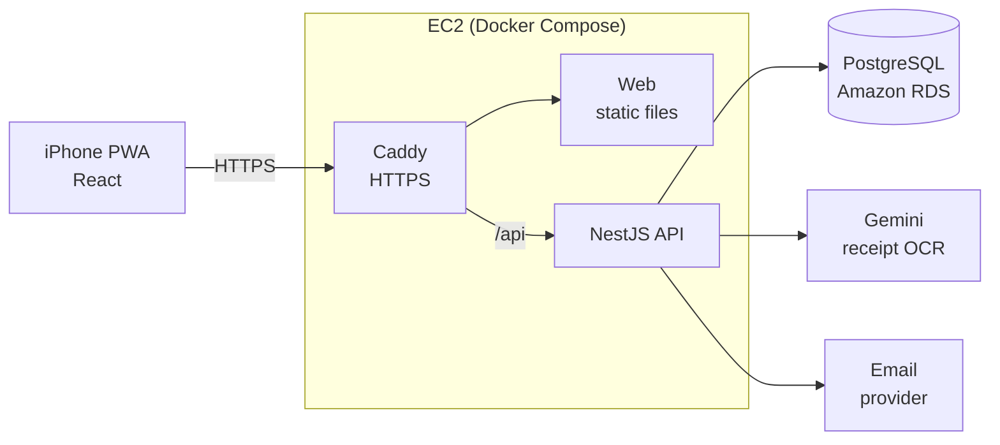
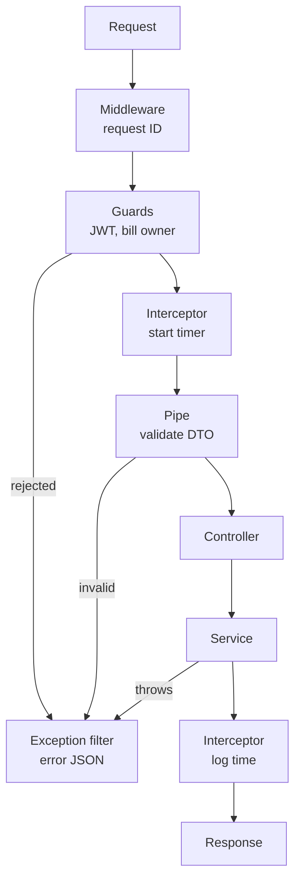

# Architecture

How SplitLah fits together, which NestJS module owns what, and what happens to one request. Design decisions are in `docs/adr/`.

## Containers

Everything in production runs with Docker Compose on one EC2 instance, except the database (Amazon RDS) and the outside services.

- **Caddy** gets a free HTTPS certificate (DuckDNS domain) and sends `/api` to the API, everything else to the web files.
- **Locally**, the API and web run with `npm run start:dev` / `npm run dev`, and Postgres runs in Docker (`infra/docker-compose.dev.yml`).
- **In tests and CI**, OCR and email are Fakes, so nothing outside is called.

## Module map

Each feature is its own NestJS module. Built so far: `PrismaModule`, `AuthModule`, `BillsModule` (bills, items, share link, claims, summary) and `SplitModule`. The rest are planned. `BillsModule` imports `SplitModule` to use `SplitService`, so the money maths has one home and is shared through dependency injection.

| Module           | Responsibility                                     | Main providers                                                    | Depends on            |
| ---------------- | -------------------------------------------------- | ----------------------------------------------------------------- | --------------------- |
| `AuthModule`     | Register, login, email verification                | `AuthService`, JWT strategy, `JwtAuthGuard`, `EmailVerifiedGuard` | Users, Email          |
| `UsersModule`    | Profile, PayNow number and QR                      | `UsersService`                                                    | Prisma                |
| `BillsModule`    | Bills, items, participants, claims, share link     | `BillsService`, `BillOwnerGuard`, `ShareTokenGuard`               | Prisma, Split         |
| `ReceiptsModule` | Receipt upload                                     | `ReceiptsService`                                                 | Ocr, Prisma           |
| `OcrModule`      | Read items from a receipt photo                    | `OCR_SERVICE` token → Gemini / Tesseract / Fake                   | none                  |
| `SplitModule`    | **Pure** money maths: charges and per-person split | `SplitService`, `billTotals()` (built)                            | none (no DB, no HTTP) |
| `ExpensesModule` | Monthly expenses, categories                       | `ExpensesService`                                                 | Prisma                |
| `PaymentsModule` | PayNow QR payload, mark paid                       | `PaymentsService`                                                 | Prisma                |
| `EmailModule`    | Send emails                                        | `EMAIL_SERVICE` token → Resend / SMTP / Fake                      | none                  |
| `PrismaModule`   | Database access, **global** (built)                | `PrismaService`                                                   | none                  |
| `HealthModule`   | `GET /health` for the deploy check                 | Health controller                                                 | Prisma                |

Why `SplitModule` has no dependencies: it only takes numbers in and returns numbers out, so its tests run in milliseconds and never need a database.

## One request, step by step

What NestJS does with a request like `PATCH /api/bills/:id` from the bill owner.

- **Middleware** adds a request ID so logs for one request can be found together.
- **Guards** say yes or no: no valid JWT → `401`; not the owner → `403`.
- **Pipe** checks the body against the DTO: bad input → `400` before the controller runs.
- **Interceptor** runs before and after the controller, e.g. to log the response time.
- **Exception filter** turns any error into one format: `{ statusCode, error, message, requestId, timestamp }`.

## Design patterns used

- **Dependency injection:** classes receive what they need through the constructor (see ADR 003).
- **Strategy pattern:** OCR and email have one interface and several implementations, chosen by config.
- **Pure core, thin edges:** the money logic is plain functions; controllers only handle HTTP.
