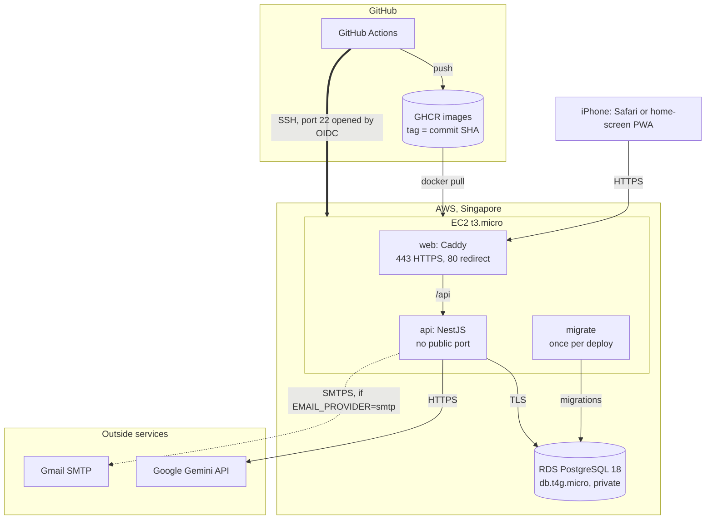
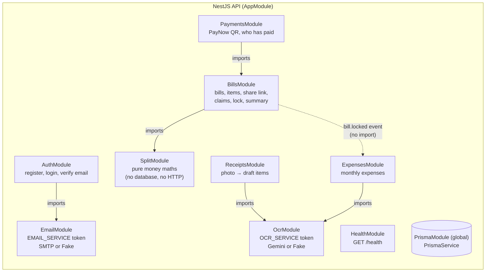
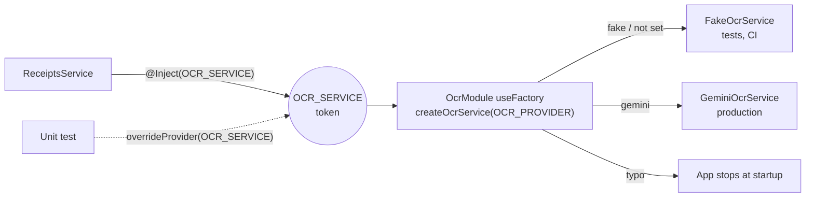
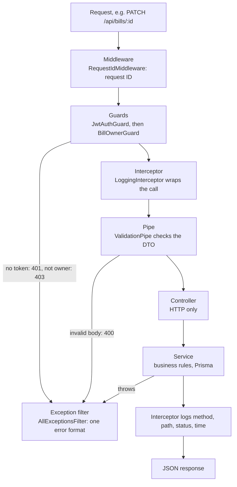
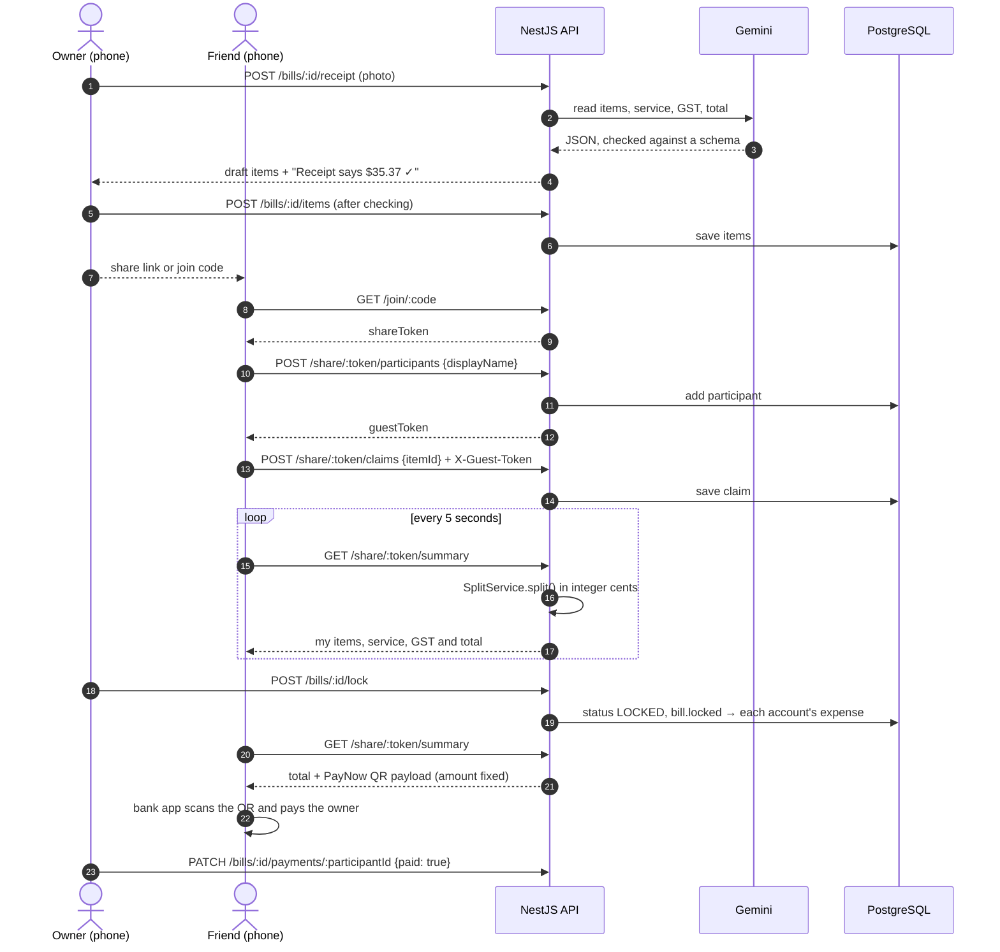

# Architecture

How SplitLah fits together, which NestJS module owns what, what happens to one request, and how one bill goes from a photo to PayNow. Design decisions are in `docs/adr/`; the tables are in [data-model.md](data-model.md). The rendered diagrams used in the report are in `docs/evidence/kan-57-*.png`.

## Deployment

Everything in production runs with Docker Compose on one EC2 instance, except the database (Amazon RDS) and the outside services.

- **Caddy** gets a free HTTPS certificate for `splitlah.duckdns.org`, serves the React files itself, and sends `/api` to the API (KAN-39). Only Caddy has a public port.
- **Web app:** React Router pages; one API client (`apps/web/src/api/client.ts`) adds the login token and turns error JSON into sentences; `AuthProvider` keeps who is logged in (KAN-42). Bill pages show totals worked out by the API, never their own (KAN-43). Friends use `/s/:token` with a guest token instead of a login, and pages refresh by polling every 5 seconds (KAN-44).
- **Deploy:** GitHub Actions pushes images to GHCR, opens port 22 for its own IP only (AWS OIDC, no stored keys), pulls, migrates, starts and health-checks, and closes the port again ([pipeline.md](pipeline.md)).
- **Locally**, the API and web run with `npm run start:dev` / `npm run dev`, and Postgres runs in Docker (`infra/docker-compose.dev.yml`).
- **In tests and CI**, OCR and email are Fakes, so nothing outside is called.

## Module map

Each feature is its own NestJS module. Arrows are `imports`; `PrismaModule` is global, so it is not drawn.

| Module           | Responsibility                                     | Main providers                                                             | Depends on            |
| ---------------- | -------------------------------------------------- | -------------------------------------------------------------------------- | --------------------- |
| `AuthModule`     | Register, login, JWT, email verification           | `AuthService`, `VerificationService`, `JwtAuthGuard`, `EmailVerifiedGuard` | Email, Prisma         |
| `BillsModule`    | Bills, items, share link, claims, lock, summary    | `BillsService`, `BillOwnerGuard`, `ShareTokenGuard`                        | Prisma, Split         |
| `PaymentsModule` | PayNow QR text, ticking who has paid               | `PaymentsService`, `buildPayNowPayload()`                                  | Bills, Prisma         |
| `SplitModule`    | **Pure** money maths: charges and per-person split | `SplitService`, `billTotals()`                                             | none (no DB, no HTTP) |
| `ReceiptsModule` | Receipt upload → draft items                       | `ReceiptsService`                                                          | Ocr, Prisma           |
| `OcrModule`      | Read items from a receipt photo                    | `OCR_SERVICE` token → Gemini / Fake                                        | none                  |
| `EmailModule`    | Send emails (the verify link)                      | `EMAIL_SERVICE` token → Gmail SMTP / Fake                                  | none                  |
| `ExpensesModule` | Expenses, monthly summary, bill shares on lock     | `ExpensesService`, `BillShareListener`                                     | Ocr, Prisma           |
| `PrismaModule`   | Database access, **global**                        | `PrismaService`                                                            | none                  |
| `HealthModule`   | `GET /health` for the deploy check                 | Health controller                                                          | Prisma                |

- **Why `SplitModule` has no dependencies:** it only takes numbers in and returns numbers out, so its tests run in milliseconds and never need a database.
- **Why the bill lock uses an event:** `BillsModule` sends `bill.locked` and `ExpensesModule` listens, so bills never import expenses. The listener uses `suppressErrors: false`, so if saving the expenses fails, the lock fails and the bill stays open.

## How OCR is injected

Code that reads receipts asks for the `OCR_SERVICE` token, not a class. `OcrModule` decides once, at startup, what sits behind that token, using the `OCR_PROVIDER` setting. Email works the same way with `EMAIL_SERVICE` and `EMAIL_PROVIDER`.

- **Swap by config:** changing `OCR_PROVIDER` changes the reader; no code that uses OCR changes.
- **Swap in a test:** `overrideProvider(OCR_SERVICE).useValue(stub)` puts any object with an `extract()` method behind the token.
- **Fail fast:** an unknown provider throws when the app starts, not on the first real receipt.

## One request, step by step

What NestJS does with a request like `PATCH /api/bills/:id` from the bill owner.

- **Middleware** adds a request ID so logs for one request can be found together.
- **Guards** say yes or no: no valid JWT → `401`; not the owner → `403`.
- **Interceptor** runs before and after the controller, to log the method, path, status and time.
- **Pipe** checks the body against the DTO: bad input → `400` before the controller runs.
- **Exception filter** turns any error into one format: `{ statusCode, error, message, requestId, timestamp }`. Unexpected errors only say "Internal server error"; the stack trace stays in the server log.

## From receipt to PayNow

One bill from the photo to the friend paying back. The numbers match the steps in the diagram.

- **1–4:** the photo goes to Gemini; the answer is checked against a schema and returned as draft items with a check against the printed total. Nothing is saved yet.
- **5–6:** the owner fixes anything wrong and saves the items.
- **7–12:** a friend uses the link or the join code (20 tries a minute per IP), joins with only a name and gets a guest token.
- **13–17:** the friend claims items; every 5 seconds the page asks for the summary, which the API works out again each time.
- **18–19:** locking stops claim changes and adds each account holder's share to their expenses.
- **20–23:** the summary now has a PayNow QR with the amount fixed; the bank app pays the owner directly (SplitLah never handles money), and the owner ticks them as paid.

## The money algorithm

All money is whole cents and every rate is basis points (1000 = 10%), so there are no floating-point errors ([ADR 002](adr/002-money-as-integer-cents.md)).

1. **Charges, as printed on the receipt:** service = 10% of the subtotal, then GST = 9% of (subtotal + service), each rounded half up: `Math.floor((amount * bp + 5000) / 10000)`.
2. **Weights:** each person's share of their items (a shared item splits equally, or by %, shares or exact amounts).
3. **Largest remainder:** items, service and GST are each split by those weights. Everyone gets the rounded-down amount, then the leftover cents go one each to the largest fractions, so the shares always add up to the receipt total.

The brief's bill (Chee: chicken rice 600; Ali: laksa 750; Ben and Dan share two Tigers at 800), in cents:

| Person   | Items     | Service (10%) | GST (9%)    | Total     |
| -------- | --------- | ------------- | ----------- | --------- |
| Chee     | 600       | 60            | 59 + 1 = 60 | 720       |
| Ali      | 750       | 75            | 74          | 899       |
| Ben      | 800       | 80            | 79          | 959       |
| Dan      | 800       | 80            | 79          | 959       |
| **Bill** | **2,950** | **295**       | **292**     | **3,537** |

The exact GST shares are 59.39, 74.24, 79.19 and 79.19. Rounded down they add up to 291, one short of 292, and Chee's 0.39 is the largest fraction, so Chee gets the spare cent. `split.service.spec.ts` checks these numbers, and property tests check that the shares add up on 1,000 random bills.

## Design patterns used

- **Dependency injection (inversion of control):** classes receive what they need through the constructor (see [ADR 003](adr/003-ocr-behind-an-interface.md)), so any provider can be replaced in a test.
- **Strategy:** OCR and email each have one interface (`extract()`, `send()`) and two implementations, chosen by config at startup.
- **Chain of responsibility:** middleware, guards, interceptor and pipe each get a turn before the controller, and any of them can stop the request.
- **Data transfer objects:** each request body is a class with validation rules, separate from the database models.
- **Observer:** `bill.locked` has one listener today; another can be added without changing `BillsModule`.
- **Pure core, thin edges:** the money logic is plain functions; controllers only handle HTTP.
