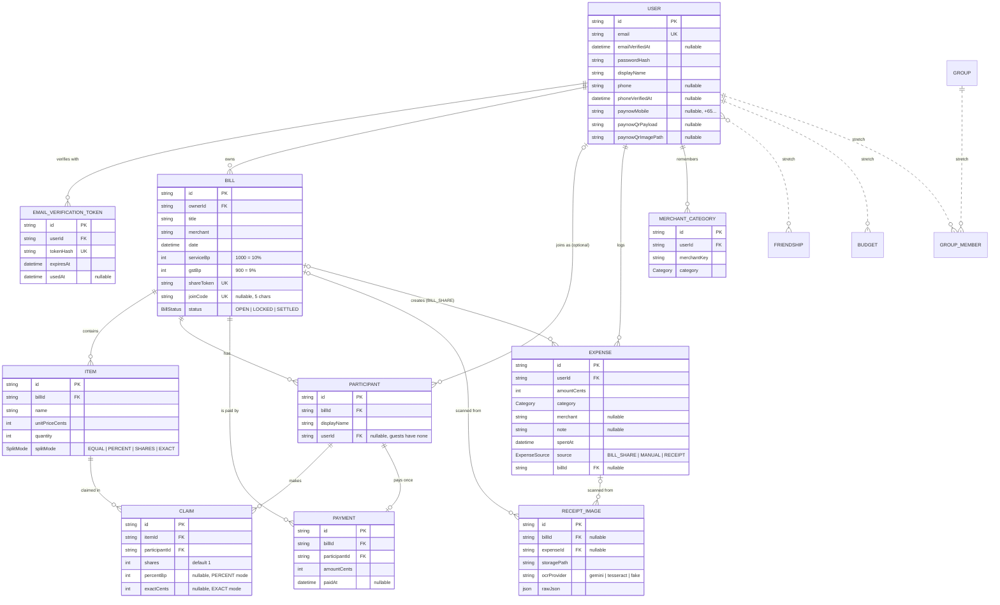

# Data model

The tables, relations and rules that `apps/api/prisma/schema.prisma` (KAN-18) is built from.

## ER diagram

Solid lines are the MVP. Dashed lines are stretch goals.

Every table also gets `createdAt` and `updatedAt`. They are left out of the diagram to keep it readable.

## Enums

| Enum            | Values                                                                                                                         |
| --------------- | ------------------------------------------------------------------------------------------------------------------------------ |
| `BillStatus`    | `OPEN`, `LOCKED`, `SETTLED`                                                                                                    |
| `SplitMode`     | `EQUAL`, `PERCENT`, `SHARES`, `EXACT`                                                                                          |
| `ExpenseSource` | `BILL_SHARE`, `MANUAL`, `RECEIPT`                                                                                              |
| `Category`      | `FOOD_DRINKS`, `GROCERIES`, `TRANSPORT`, `SHOPPING`, `GIFTS`, `ENTERTAINMENT`, `BILLS_UTILITIES`, `HEALTH`, `TRAVEL`, `OTHERS` |

## Decisions

| Decision                                                                                                       | Why                                                                                                                                                        |
| -------------------------------------------------------------------------------------------------------------- | ---------------------------------------------------------------------------------------------------------------------------------------------------------- |
| Money is `Int` cents (`600` = $6.00)                                                                           | Floats cannot store 0.1 exactly, so totals drift by a cent; integers never do.                                                                             |
| Rates and percents are `Int` basis points (`1000` = 10%, `900` = 9%, `10000` = 100%)                           | Same reason as money, and it keeps 2 decimal places of a percent without fractions.                                                                        |
| IDs are `String` with `cuid()`                                                                                 | IDs appear in URLs; random IDs do not reveal how many bills exist.                                                                                         |
| `Bill.shareToken` is unique                                                                                    | The share link finds the bill by this token, so two bills can never share one.                                                                             |
| `Bill.joinCode` is unique and nullable                                                                         | A short code friends can type instead of opening the link. Added in KAN-27 as an additive migration, so it is nullable: bills made before it have no code. |
| `Participant.userId` is nullable                                                                               | Friends join by link with only a name (no sign-up).                                                                                                        |
| `Claim` holds `shares`, `percentBp?`, `exactCents?`                                                            | One table covers all four split modes; the item's `splitMode` says which field is used.                                                                    |
| Unique `Claim (itemId, participantId)`                                                                         | A person claims an item once; changing the split edits that row.                                                                                           |
| Unique `Payment (billId, participantId)`                                                                       | Each person has one amount to pay back per bill.                                                                                                           |
| Unique `Expense (userId, billId)`                                                                              | Locking a bill twice must not log the same share twice.                                                                                                    |
| Unique `MerchantCategory (userId, merchantKey)`                                                                | One remembered category per merchant per user; a correction overwrites it.                                                                                 |
| `EmailVerificationToken.tokenHash` stores a hash, not the token                                                | If the database leaks, the tokens in it cannot be used.                                                                                                    |
| Deleting a `Bill` cascades to its Items, Participants, Claims, Payments, ReceiptImages and BILL_SHARE Expenses | No orphan rows point at a bill that no longer exists.                                                                                                      |
| Indexes on `Bill.ownerId`, `Item.billId`, `Claim.itemId`, `Expense (userId, spentAt)`                          | These are the common lookups: "my bills", "items in a bill", "claims on an item", "my month".                                                              |
| Stretch tables (`Friendship`, `Budget`, `Group`, `GroupMember`) are not in the first migration                 | Keep the MVP small; add them later as additive migrations.                                                                                                 |

## Example: the brief's test bill

| Item         | Price | Claimed by | Split |
| ------------ | ----- | ---------- | ----- |
| Chicken Rice | 600   | Chee       | EQUAL |
| Laksa        | 750   | Ali        | EQUAL |
| Tiger × 2    | 1600  | Ben, Dan   | EQUAL |

Stored as 1 `Bill` (`serviceBp` 1000, `gstBp` 900), 3 `Item`s, 4 `Participant`s and 4 `Claim`s.
Expected totals: subtotal 2950, service 295, GST 292, total 3537 → Chee 720, Ali 899, Ben 959, Dan 959.
