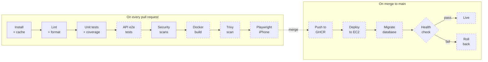

# CI/CD pipeline

The plan for the whole pipeline, and which parts exist today. The workflow lives in `.github/workflows/ci.yml`.

## Stages

Solid boxes are built. Dashed boxes are planned for later sprints.

| Stage                    | Details                                               |
| ------------------------ | ----------------------------------------------------- |
| Install + cache          | `npm ci`, npm cache keyed on the lockfile             |
| Lint + format            | oxlint (`--deny-warnings`), Prettier check            |
| Unit tests + coverage    | Vitest; fails below 90% on `src/split`                |
| API e2e tests            | Supertest against a Postgres service container        |
| Security scans           | Gitleaks (built), CodeQL, `npm audit`                 |
| Docker build             | Multi-stage images for api and web                    |
| Trivy scan               | Scans the images for known vulnerabilities            |
| Playwright iPhone        | Browser tests with the iPhone preset                  |
| Push to GHCR             | Images tagged with the commit SHA and `latest`        |
| Deploy to EC2            | SSH in, pull the new images, restart                  |
| Migrate database         | `prisma migrate deploy` on RDS                        |
| Health check / roll back | `GET /health`; on failure, restart the previous image |

Security scans are partly built: Gitleaks runs today; CodeQL and `npm audit` come later.

## What runs today

All jobs start at the same time, on every PR and every push to `main`. A new push to the same branch cancels the run still in progress.

| Job        | What it does                                         | Fails when                               |
| ---------- | ---------------------------------------------------- | ---------------------------------------- |
| `gitleaks` | Scans the full git history for secrets               | A key, token or password is found        |
| `lint api` | `npm ci`, oxlint (`--deny-warnings`), Prettier check | Any lint warning or unformatted file     |
| `lint web` | Same, for `apps/web`                                 | Same                                     |
| `test-api` | Vitest with coverage, uploads the coverage report    | A test fails or `src/split` is below 90% |
| `test-web` | Vitest                                               | A test fails                             |

All 5 are required checks on `main`. A typical run takes under 1 minute.

## Environments

| Environment | Where it runs                                 | Database                                     | OCR and email             |
| ----------- | --------------------------------------------- | -------------------------------------------- | ------------------------- |
| Local       | My laptop, `infra/docker-compose.dev.yml`     | Postgres 18 in Docker, port 5433             | Fake (or real, by `.env`) |
| CI          | GitHub Actions runners                        | Postgres service container (planned for e2e) | Always Fake               |
| Production  | One EC2 instance, Docker Compose, Caddy HTTPS | Amazon RDS, Postgres 18                      | Gemini, real email        |

## Secrets

None of these are ever committed. `.env` files are gitignored; only `.env.example` files with placeholder values are in git.

| Secret           | Lives in                   | Used for                                     |
| ---------------- | -------------------------- | -------------------------------------------- |
| `EC2_HOST`       | GitHub Secrets             | Address the deploy job connects to           |
| `EC2_USER`       | GitHub Secrets             | SSH user on the server                       |
| `EC2_SSH_KEY`    | GitHub Secrets             | Private key for the SSH deploy               |
| `DATABASE_URL`   | Server `.env`              | API connection to RDS                        |
| `JWT_SECRET`     | Server `.env`              | Signing login tokens                         |
| `GEMINI_API_KEY` | Server `.env`              | Receipt reading                              |
| `OCR_PROVIDER`   | Server `.env`              | Chooses Gemini / Tesseract / Fake            |
| `EMAIL_*`        | Server `.env`              | Sending verification emails                  |
| `GITHUB_TOKEN`   | Provided by GitHub Actions | Pushing images to GHCR, Gitleaks PR comments |

The Jira ticket also listed `AWS_ACCESS_KEY_ID` and `AWS_SECRET_ACCESS_KEY`. They are not needed: the deploy uses SSH, and the API reaches RDS through `DATABASE_URL`, so no AWS API keys are stored anywhere.

## Rules

- Migrations are additive only (add columns and tables, never drop in the same release), so a rollback to the previous image still works with the new database.
- Tests and CI always use the Fake OCR and email services, so CI never costs money or sends real emails.
