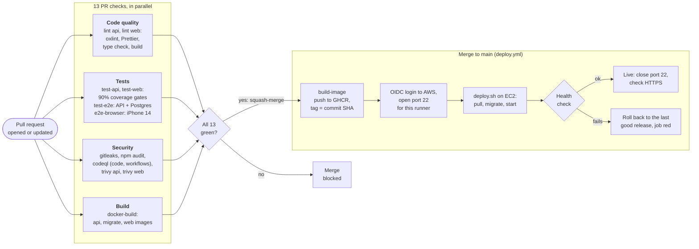

# CI/CD pipeline

The plan for the whole pipeline, and which parts exist today. The workflows live in `.github/workflows/`: `ci.yml` (checks), `codeql.yml` (code scanning), `deploy.yml` (release) and `k6.yml` (load test, manual only).

## Stages

Every box is built. The 13 PR checks start together, not one after another, so a PR waits only for the slowest one (source: [diagrams/pipeline.mmd](diagrams/pipeline.mmd), image: [kan-51-pipeline-diagram.png](evidence/kan-51-pipeline-diagram.png)).



The browser tests came last (KAN-53). The security checks were added in KAN-41: what they found and the accepted risks are in [security.md](security.md).

## What runs today

All jobs start at the same time, on every PR and every push to `main`. A new push to the same branch cancels the run still in progress.

| Job                                              | What it does                                                                                                                                                                                                                                                                                               | Fails when                                                                                                |
| ------------------------------------------------ | ---------------------------------------------------------------------------------------------------------------------------------------------------------------------------------------------------------------------------------------------------------------------------------------------------------- | --------------------------------------------------------------------------------------------------------- |
| `gitleaks`                                       | Scans the full git history for secrets                                                                                                                                                                                                                                                                     | A key, token or password is found                                                                         |
| `lint api`                                       | `npm ci`, oxlint (`--deny-warnings`), Prettier check, type-check (`tsc --noEmit`, tests included), build                                                                                                                                                                                                   | Any lint warning, unformatted file, type error or failed build                                            |
| `lint web`                                       | Same, for `apps/web`                                                                                                                                                                                                                                                                                       | Same                                                                                                      |
| `test-api`                                       | Vitest with coverage, uploads the coverage report (`lcov.info`, HTML) and the results as JSON                                                                                                                                                                                                              | A test fails or any of `src/split`, `common`, `auth`, `bills`, `ocr`, `receipts`, `expenses` is below 90% |
| `test-web`                                       | Vitest with coverage: component tests in a fake browser (jsdom) with a fake API                                                                                                                                                                                                                            | A test fails or `apps/web/src` is below 90%                                                               |
| `test-e2e`                                       | Starts a fresh Postgres 18 service container, `prisma migrate deploy`, then the API e2e tests (Supertest) with a random `JWT_SECRET`                                                                                                                                                                       | A migration fails, or any e2e test fails                                                                  |
| `e2e-browser`                                    | Builds the real images and starts them with `infra/docker-compose.ci.yml` (Postgres, migrations, API with Fake OCR and email, Caddy on port 8080), then Playwright drives WebKit as an iPhone 14 through the whole journey, inside Microsoft's Playwright image; on failure it uploads the trace and video | A browser step fails                                                                                      |
| `docker-build`                                   | Builds the API, migrate and web images (`apps/api/Dockerfile`, `apps/web/Dockerfile`, no push), reusing cached layers                                                                                                                                                                                      | An image does not build, or the Caddyfile is invalid                                                      |
| `npm audit`                                      | `npm audit` through audit-ci: every package in `package-lock.json` against known advisories                                                                                                                                                                                                                | A HIGH or CRITICAL advisory that is not accepted in `audit-ci.jsonc`                                      |
| `trivy api`, `trivy web`                         | Builds each image and scans the OS packages and binaries in it; results go to the Security tab                                                                                                                                                                                                             | A HIGH or CRITICAL CVE that has a fix (except the accepted ones in `.trivyignore.yaml`)                   |
| `codeql javascript-typescript`, `codeql actions` | `codeql.yml`: reads our TypeScript and the workflow files for security bugs (also weekly)                                                                                                                                                                                                                  | A new security finding                                                                                    |

All 13 are required checks on `main`. A typical run takes about 4 minutes; `e2e-browser` is the slowest job (it builds the images without the layer cache, then runs the browser). The npm cache was measured to save almost nothing (see the KAN-50 learning-log entry); Docker's layer cache is the one that saves time. Two runs took about 30 minutes because `playwright install --with-deps` downloaded WebKit's system libraries from a slow Ubuntu mirror; since KAN-100 the browser tests run in Microsoft's Playwright image (`mcr.microsoft.com/playwright`, tagged with the installed `@playwright/test` version), which already has them.

## QA report (KAN-102)

Two more jobs in `ci.yml` turn the test results into a report and publish it to GitHub Pages: **https://cheewei0123.github.io/ay2626s2-cicdp-ChongCheeWei/**. They are not required checks, so a problem with the report can't block a merge; the tests themselves already do that.

| Job                 | Runs                                                             | What it does                                                                                                                                                                                                                                                                                         |
| ------------------- | ---------------------------------------------------------------- | ---------------------------------------------------------------------------------------------------------------------------------------------------------------------------------------------------------------------------------------------------------------------------------------------------- |
| `QA report`         | Every PR and push, after the four test jobs (even if one failed) | Checks the report's own code (Prettier, `tsc`, `node --test`), downloads the test jobs' artifacts (`coverage-api`, `coverage-web`, `e2e-results`, `playwright-report`), runs `qa/report.ts` and uploads `qa/site` as the `github-pages` artifact. On a PR the report can be downloaded from the run. |
| `publish QA report` | Push to `main` only                                              | Publishes that artifact with `actions/deploy-pages` in the `github-pages` environment. Its token gets `pages: write` and `id-token: write` (Pages checks the upload came from this workflow); every other job keeps read-only.                                                                       |

**lcov.** Both Vitest configs set `reporter: ['text', 'lcov']`: the text table stays in the CI log, and lcov writes `coverage/lcov.info` (the standard coverage format, one record per file with lines, branches and functions found and hit) and an HTML report in `coverage/lcov-report`. `qa/report.ts` reads `lcov.info`, adds up each folder and compares it with the gates it reads from the Vitest config, so the page and CI can't disagree. It copies the HTML reports to the site as they are. The test counts come from Vitest's and Playwright's JSON reporters.

## On merge to `main` (`.github/workflows/deploy.yml`)

| Job           | What it does                                                                                                                                                                                  |
| ------------- | --------------------------------------------------------------------------------------------------------------------------------------------------------------------------------------------- |
| `build-image` | Builds the API, migrate and web images and pushes them to GHCR as `ghcr.io/cheewei0123/splitlah-<api\|migrate\|web>:<commit SHA>` and `:latest`, logging in with the run's own `GITHUB_TOKEN` |
| `deploy`      | Runs in the `production` environment and ships that exact SHA to EC2 (steps below)                                                                                                            |

The deploy job, step by step:

1. **OIDC login to AWS:** GitHub gives the job a signed token; AWS checks it and lets the job use the `splitlah-github-deploy` role for a short time. No AWS keys are stored anywhere.
2. **Open port 22 for this runner only:** the role may only add or remove inbound rules on the server's security group. It adds `<runner IP>/32`.
3. **SSH in as `deploy`** with `EC2_SSH_KEY`, checking the server against the pinned fingerprint in `EC2_KNOWN_HOSTS`.
4. **`deploy.sh <SHA>`** on the server: pull the new `splitlah-api` and `splitlah-migrate` images → `prisma migrate deploy` → `docker compose up -d` → wait for `GET /api/health`.
5. **Roll back** if the health check fails: start the last release that passed (`.deployed-tag`), and fail the job so it shows red.
6. **Close port 22 again**, always, even if a step failed.
7. **Check from the internet:** `curl http://<server>/api/health`.

Only one deploy runs at a time (`concurrency`), and only `main` can deploy to `production`.

**Build cache (one scope per Dockerfile).** Docker layers are kept in GitHub's cache (`type=gha`) between runs. Each Dockerfile has its own scope (`scope=api`, `scope=web`): with one shared scope, every build replaced the cache record of the one before, so the web build never found its Caddy layer and rebuilt Caddy from source (about 75 s) on every run. The migrate image only reads the `api` scope, because its layers are the API build stage that the API build already saves. Before this fix, merge to live had grown from about 2½ minutes (Sprint 2) to a median of about 7½ minutes (21–22 Nov).

**Measured deploy times** (from the deploy runs' own timings in the GitHub API):

| When                  | What was built                       | Deploys | Merge to live (median)                 |
| --------------------- | ------------------------------------ | ------- | -------------------------------------- |
| 8–10 Nov              | API and migrate images               | 15      | 2 min 14 s                             |
| 10–16 Nov             | API, migrate and web (Caddy) images  | 8       | 5 min 1 s                              |
| 20–22 Nov             | Same, one shared cache record        | 19      | 7 min 24 s                             |
| 22 Nov, after the fix | Same, one cache scope per Dockerfile | 2       | 2 min 29 s (re-run), 3 min 4 s (merge) |

The first deploy after the fix (#46, 8 min 16 s) filled the new cache scopes; the next one (#47, run by hand on the same commit) took 2 min 29 s, with the image build down from 4–6½ minutes to 64 s. The next real merge (KAN-58 docs, #99) went live in 3 min 4 s, because a new commit rebuilds a few more layers. Screenshot: [kan-58-deploy-times-before-after.png](evidence/kan-58-deploy-times-before-after.png).

**Image sizes** (current release, compressed as stored in GHCR): `splitlah-api` 123 MB, `splitlah-web` 43 MB, `splitlah-migrate` 429 MB (it carries the Prisma CLI and only runs once per deploy). All three run as a non-root user.

## Secrets and settings for the deploy

| Name                  | Kind                      | What                                                                                  |
| --------------------- | ------------------------- | ------------------------------------------------------------------------------------- |
| `AWS_DEPLOY_ROLE_ARN` | Secret (`production`)     | The IAM role the deploy job uses through OIDC                                         |
| `EC2_SSH_KEY`         | Secret (`production`)     | Private key for the `deploy` user                                                     |
| `EC2_KNOWN_HOSTS`     | Secret (`production`)     | The server's SSH fingerprint, so an impostor server is refused                        |
| `EC2_HOST`            | Variable (`production`)   | Server address (public anyway, so not a secret)                                       |
| `EC2_SG_ID`           | Variable (`production`)   | The security group the deploy job may change                                          |
| `.env` on the server  | File, `deploy` only (600) | `DATABASE_URL` (RDS), `JWT_SECRET`, `WEB_ORIGIN`, Gemini settings, made on the server |

The IAM role can only be used by this repository's `production` environment (its trust policy checks the token's `sub` exactly), and its permission covers only `AuthorizeSecurityGroupIngress` / `RevokeSecurityGroupIngress` on that one security group.

## The API image

| Image                                                  | Size   | Runs as |
| ------------------------------------------------------ | ------ | ------- |
| Naive single-stage (`node:24`, everything)             | 2.7 GB | `root`  |
| Multi-stage (`node:24-slim`, production packages only) | 505 MB | `node`  |

- **3 stages:** `build` (all packages, `prisma generate`, `nest build`) → `prod-deps` (`npm ci --omit=dev --omit=optional --ignore-scripts`) → `runtime` (copies only `node_modules` and `dist/`).
- `.dockerignore` keeps `.env` files, `.git`, tests and docs out of the build, so secrets can never end up in an image. Settings like `DATABASE_URL` and `JWT_SECRET` are passed in when the container starts.
- `HEALTHCHECK` calls `GET /api/health` every 15 seconds; Docker marks the container unhealthy if it stops answering `200`.

## Environments

| Environment | Where it runs                                 | Database                                      | OCR and email             |
| ----------- | --------------------------------------------- | --------------------------------------------- | ------------------------- |
| Local       | My laptop, `infra/docker-compose.dev.yml`     | Postgres 18 in Docker, port 5433              | Fake (or real, by `.env`) |
| CI          | GitHub Actions runners                        | Postgres 18 service container, fresh each run | Always Fake               |
| Production  | One EC2 instance, Docker Compose, Caddy HTTPS | Amazon RDS, Postgres 18                       | Gemini, real email        |

## Secrets

None of these are ever committed. `.env` files are gitignored; only `.env.example` files with placeholder values are in git.

| Secret                   | Lives in                   | Used for                                               |
| ------------------------ | -------------------------- | ------------------------------------------------------ |
| `EC2_HOST`               | GitHub Secrets             | Address the deploy job connects to                     |
| `EC2_USER`               | GitHub Secrets             | SSH user on the server                                 |
| `EC2_SSH_KEY`            | GitHub Secrets             | Private key for the SSH deploy                         |
| `DATABASE_URL`           | Server `.env`              | API connection to RDS                                  |
| `JWT_SECRET`             | Server `.env`              | Signing login tokens                                   |
| `GEMINI_API_KEY`         | Server `.env`              | Receipt reading                                        |
| `OCR_PROVIDER`           | Server `.env`              | Chooses Gemini / Tesseract / Fake                      |
| `SMTP_USER`, `SMTP_PASS` | Server `.env`              | Gmail address and app password for verification emails |
| `GITHUB_TOKEN`           | Provided by GitHub Actions | Pushing images to GHCR, Gitleaks PR comments           |

The Jira ticket also listed `AWS_ACCESS_KEY_ID` and `AWS_SECRET_ACCESS_KEY`. They are not needed: the deploy uses SSH, and the API reaches RDS through `DATABASE_URL`, so no AWS API keys are stored anywhere.

## Rules

- Migrations are additive only (add columns and tables, never drop in the same release), so a rollback to the previous image still works with the new database.
- Tests and CI always use the Fake OCR and email services, so CI never costs money or sends real emails.

## Browser tests (Playwright, KAN-53)

`apps/web/e2e/split-a-bill.spec.ts` has two tests that run in order, like the brief's story:

1. **Owner:** register → open the verify link (the Fake email writes it to the API log; the test reads it with `docker compose logs`, or from the file in `API_LOG`, which CI sets because the Playwright image has no `docker` command) → new bill → upload a receipt photo (Fake OCR reads the brief's bill, $35.37 ✓) → change Laksa to $8.50 (the page now warns the total differs) → share, and note the join code.
2. **Guest**, in a fresh browser context (another phone, not logged in): join with the code → enter a name → tap all three items → "My total so far" equals the owner's new total.

Run it locally the same way CI does:

```sh
docker compose -f infra/docker-compose.ci.yml up -d --wait db
docker compose -f infra/docker-compose.ci.yml run --rm --build migrate
docker compose -f infra/docker-compose.ci.yml up -d --build --wait api web
npm run test:browser -w apps/web
docker compose -f infra/docker-compose.ci.yml down
```

A failed test keeps `trace.zip` and `video.webm` in `apps/web/test-results/`; CI uploads them as the `playwright-trace` artifact. Open a trace at [trace.playwright.dev](https://trace.playwright.dev) to step through every click, network call and screen.

## Load test (k6, KAN-55)

`qa/k6/smoke.js` runs from `.github/workflows/k6.yml`, which only starts by hand (Actions → k6 → Run workflow), so normal PRs and merges never put load on production. k6 is installed by Grafana's action, pinned to a commit.

- **load:** 10 virtual users for 1 minute. Each opens the app page (Caddy) and calls `/api/health` (NestJS → a query on RDS), then waits 1 second, like a person between screens.
- **Thresholds (the job fails if missed):** 95% of requests under 500 ms, and under 1% failed.
- **ratelimit:** after the load, 25 quick guesses at a join code from one IP. The first 20 must get `404` and the rest `429`, which proves the 20-a-minute limit on `/api/join` works on the live server, behind Caddy.

Health and the app page are used because they have no rate limit; a share link allows 100 requests a minute per IP, so 10 users from one runner would mostly measure the limiter. While k6 runs, the job also samples `docker stats` on the server about every 10 seconds over SSH (CPU and memory of each container, plus `free -m` once). It gets in the same way as the deploy job: the `production` environment, OIDC, and port 22 opened for the runner's IP only, then closed again even if a step fails. The summary and `server-stats.txt` are uploaded as the `k6-summary` artifact (30 days). The runner is in the US, so its times include the trip to Singapore that a local user wouldn't have.

### Results (22 Nov 2026)

Two runs from GitHub's US runner against the live site; the second also sampled the server. Full output: [qa/results/k6-2026-11-22.txt](../qa/results/k6-2026-11-22.txt).

| Run                        | p50    | p95    | Max    | Errors     | Requests/s | Server CPU (API / Caddy) | API memory  |
| -------------------------- | ------ | ------ | ------ | ---------- | ---------- | ------------------------ | ----------- |
| k6 #1                      | 199 ms | 202 ms | 261 ms | 0% (0/860) | 14.3       | not sampled              | not sampled |
| k6 #2 (with server sample) | 224 ms | 230 ms | 439 ms | 0% (0/820) | 13.7       | 2–3% / 1–4%              | 92–119 MiB  |

Requests/s is the load scenario only (requests ÷ 60 s). The rate-limit check passed both times: 20 guesses got `404`, the next 5 got `429`.

**What this shows, and what limits the system.** At 10 users the server is almost idle: the API used 2–3% CPU and Caddy 1–4%, and the response time hardly changes from p50 to p95 (5 ms apart). So nearly all of the ~200 ms is the trip from the US runner to Singapore, not work on the server; a user in Singapore would see much less. One API sample read 23% for a second just after the load ended (2% before, 0% after), which I can't tie to one request. The tightest resource is **memory**, not CPU: the t3.micro has 909 MiB, about 500 MiB was in use and 108 MiB was already in swap at the start of the test, with the API at about 92–119 MiB and Caddy at 58 MiB. The real limits are: **one small server** (no second copy, so a crash or a slow deploy is downtime, and a t3.micro has CPU credits that run out under long heavy load); **memory** (more traffic or more containers would push it further into swap and slow down); **receipt scanning**, which waits seconds for Gemini, is rate-limited to 5 a minute per IP and bounded by Gemini's free-tier quota, so the AI is the bottleneck there, not my CPU; and **the rate limit counters**, which live in each API's memory, so running a second copy would need a shared store such as Redis or each copy would allow its own 20 guesses. I did not push for the breaking point on purpose: it is the only production server, on the free tier.

Run it from a laptop with k6 installed:

```sh
k6 run qa/k6/smoke.js                                   # production
k6 run -e BASE_URL=http://localhost:8080 qa/k6/smoke.js # the Docker stack above
```
