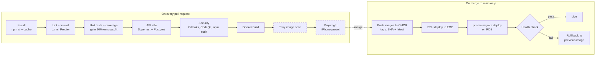

# CI/CD pipeline

The plan for the whole pipeline, and which parts exist today. The workflow lives in `.github/workflows/ci.yml`.

## Stages

Solid boxes are built. Dashed boxes are planned for later sprints.

Stage E is partly built: Gitleaks runs today; CodeQL and `npm audit` come later.

## What runs today

All jobs start at the same time, on every PR and every push to `main`. A new push to the same branch cancels the run still in progress.

| Job            | What it does                                                                                                                         | Fails when                                                                         |
| -------------- | ------------------------------------------------------------------------------------------------------------------------------------ | ---------------------------------------------------------------------------------- |
| `gitleaks`     | Scans the full git history for secrets                                                                                               | A key, token or password is found                                                  |
| `lint api`     | `npm ci`, oxlint (`--deny-warnings`), Prettier check, type-check (`tsc --noEmit`, tests included), build                             | Any lint warning, unformatted file, type error or failed build                     |
| `lint web`     | Same, for `apps/web`                                                                                                                 | Same                                                                               |
| `test-api`     | Vitest with coverage, uploads the coverage report                                                                                    | A test fails or `src/split` / `src/common` / `src/auth` / `src/bills` is below 90% |
| `test-web`     | Vitest with coverage: component tests in a fake browser (jsdom) with a fake API                                                      | A test fails or `apps/web/src` is below 90%                                        |
| `test-e2e`     | Starts a fresh Postgres 18 service container, `prisma migrate deploy`, then the API e2e tests (Supertest) with a random `JWT_SECRET` | A migration fails, or any e2e test fails                                           |
| `docker-build` | Builds the API, migrate and web images (`apps/api/Dockerfile`, `apps/web/Dockerfile`, no push), reusing cached layers                | An image does not build, or the Caddyfile is invalid                               |

All 7 are required checks on `main`. A typical run takes about 2–2½ minutes; `docker-build` is the slowest job. The npm cache was measured to save almost nothing (see the KAN-50 learning-log entry); Docker's layer cache is the one that saves time.

## On merge to `main` (`.github/workflows/deploy.yml`)

| Job           | What it does                                                                                                                                                                                  |
| ------------- | --------------------------------------------------------------------------------------------------------------------------------------------------------------------------------------------- |
| `build-image` | Builds the API, migrate and web images and pushes them to GHCR as `ghcr.io/cheewei0123/splitlah-<api\|migrate\|web>:<commit SHA>` and `:latest`, logging in with the run's own `GITHUB_TOKEN` |
| `deploy`      | Runs in the `production` environment and ships that exact SHA to EC2 (steps below)                                                                                                            |

The deploy job, step by step:

1. **OIDC login to AWS:** GitHub gives the job a signed token; AWS checks it and lets the job use the `splitlah-github-deploy` role for a short time. No AWS keys are stored anywhere.
2. **Open port 22 for this runner only:** the role may only add or remove inbound rules on the server's security group. It adds `<runner IP>/32`.
3. **SSH in as `deploy`** with `EC2_SSH_KEY`, checking the server against the pinned fingerprint in `EC2_KNOWN_HOSTS`.
4. **`deploy.sh <SHA>`** on the server: pull the new `splitlah-api` and `splitlah-migrate` images → `prisma migrate deploy` → `docker compose up -d` → wait for `GET /api/health`.
5. **Roll back** if the health check fails: start the last release that passed (`.deployed-tag`), and fail the job so it shows red.
6. **Close port 22 again**, always, even if a step failed.
7. **Check from the internet:** `curl http://<server>/api/health`.

Only one deploy runs at a time (`concurrency`), and only `main` can deploy to `production`.

## Secrets and settings for the deploy

| Name                  | Kind                      | What                                                                                  |
| --------------------- | ------------------------- | ------------------------------------------------------------------------------------- |
| `AWS_DEPLOY_ROLE_ARN` | Secret (`production`)     | The IAM role the deploy job uses through OIDC                                         |
| `EC2_SSH_KEY`         | Secret (`production`)     | Private key for the `deploy` user                                                     |
| `EC2_KNOWN_HOSTS`     | Secret (`production`)     | The server's SSH fingerprint, so an impostor server is refused                        |
| `EC2_HOST`            | Variable (`production`)   | Server address (public anyway, so not a secret)                                       |
| `EC2_SG_ID`           | Variable (`production`)   | The security group the deploy job may change                                          |
| `.env` on the server  | File, `deploy` only (600) | `DATABASE_URL` (RDS), `JWT_SECRET`, `WEB_ORIGIN`, Gemini settings, made on the server |

The IAM role can only be used by this repository's `production` environment (its trust policy checks the token's `sub` exactly), and its permission covers only `AuthorizeSecurityGroupIngress` / `RevokeSecurityGroupIngress` on that one security group.

## The API image

| Image                                                  | Size   | Runs as |
| ------------------------------------------------------ | ------ | ------- |
| Naive single-stage (`node:24`, everything)             | 2.7 GB | `root`  |
| Multi-stage (`node:24-slim`, production packages only) | 505 MB | `node`  |

- **3 stages:** `build` (all packages, `prisma generate`, `nest build`) → `prod-deps` (`npm ci --omit=dev --omit=optional --ignore-scripts`) → `runtime` (copies only `node_modules` and `dist/`).
- `.dockerignore` keeps `.env` files, `.git`, tests and docs out of the build, so secrets can never end up in an image. Settings like `DATABASE_URL` and `JWT_SECRET` are passed in when the container starts.
- `HEALTHCHECK` calls `GET /api/health` every 15 seconds; Docker marks the container unhealthy if it stops answering `200`.

## Environments

| Environment | Where it runs                                 | Database                                      | OCR and email             |
| ----------- | --------------------------------------------- | --------------------------------------------- | ------------------------- |
| Local       | My laptop, `infra/docker-compose.dev.yml`     | Postgres 18 in Docker, port 5433              | Fake (or real, by `.env`) |
| CI          | GitHub Actions runners                        | Postgres 18 service container, fresh each run | Always Fake               |
| Production  | One EC2 instance, Docker Compose, Caddy HTTPS | Amazon RDS, Postgres 18                       | Gemini, real email        |

## Secrets

None of these are ever committed. `.env` files are gitignored; only `.env.example` files with placeholder values are in git.

| Secret           | Lives in                   | Used for                                     |
| ---------------- | -------------------------- | -------------------------------------------- |
| `EC2_HOST`       | GitHub Secrets             | Address the deploy job connects to           |
| `EC2_USER`       | GitHub Secrets             | SSH user on the server                       |
| `EC2_SSH_KEY`    | GitHub Secrets             | Private key for the SSH deploy               |
| `DATABASE_URL`   | Server `.env`              | API connection to RDS                        |
| `JWT_SECRET`     | Server `.env`              | Signing login tokens                         |
| `GEMINI_API_KEY` | Server `.env`              | Receipt reading                              |
| `OCR_PROVIDER`   | Server `.env`              | Chooses Gemini / Tesseract / Fake            |
| `EMAIL_*`        | Server `.env`              | Sending verification emails                  |
| `GITHUB_TOKEN`   | Provided by GitHub Actions | Pushing images to GHCR, Gitleaks PR comments |

The Jira ticket also listed `AWS_ACCESS_KEY_ID` and `AWS_SECRET_ACCESS_KEY`. They are not needed: the deploy uses SSH, and the API reaches RDS through `DATABASE_URL`, so no AWS API keys are stored anywhere.

## Rules

- Migrations are additive only (add columns and tables, never drop in the same release), so a rollback to the previous image still works with the new database.
- Tests and CI always use the Fake OCR and email services, so CI never costs money or sends real emails.
