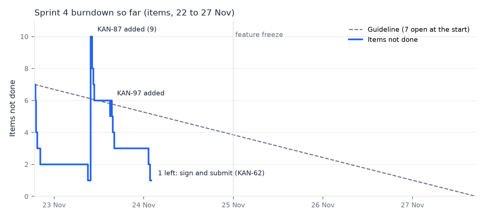

# Sprint 4: review and retro (so far)

**Sprint goal:** feature freeze on 24 Nov; the report, the evidence and the submission before 27 Nov 5 pm.

**Written:** 24 Nov 2026, before the sprint ends on 27 Nov. Only signing and submitting (KAN-62) is left.

## Review

- **Report work done:** the last checks and screenshots (KAN-50, KAN-77, KAN-80), the README check from a clean clone (KAN-54), the critical analysis (KAN-59), the Gantt chart and burndowns (KAN-60), and the scope change for the demo rehearsal (KAN-61).
- **Added on 23 Nov: the account-safety epic (KAN-87).** Feedback on the app asked for account recovery, safer logins, account deletion and better expense views, so 10 items were added to the sprint and built before the 24 Nov feature freeze:

| Ticket | What                                                                                     |
| ------ | ---------------------------------------------------------------------------------------- |
| KAN-88 | Upload a receipt from Photos; at most 20 AI scans per account a day                      |
| KAN-89 | Fixed +65 phone field where you type only the 8 digits                                   |
| KAN-90 | Forgot, reset and change password; a password change logs out other devices              |
| KAN-91 | The PayNow number is checked before friends can pay it (Telegram bot; SMS built, not on) |
| KAN-94 | Calendar range picker; bars, pie and over-time charts for expenses                       |
| KAN-97 | A login lasts 14 days; logout ends it on the server                                      |
| KAN-92 | Two-step login with an authenticator app and backup codes                                |
| KAN-93 | Delete your account; closed at once, wiped 6 months later                                |
| KAN-95 | Continue with Google                                                                     |
| KAN-96 | OWASP Top 10 checklist; security headers on the web server                               |

- **Every item went through the same 13 required checks** and was checked on the live site after its deploy.
- **Not done:** SMS codes are built and tested but not switched on, because AWS's free account plan can't send SMS (see [infra.md](../infra.md)). The live site checks numbers with the Telegram bot instead.

**Numbers:** 17 PRs merged to `main` from the start of the sprint to 24 Nov, 2 am. 528 API unit tests (98.7% lines, 95.9% branches), 22 API e2e files, 224 web tests and 3 browser tests, all green.

### Burndown

Drawn by items, not points, from Jira's created and resolved times: the 10 items added on 23 Nov have no story points, so Jira's points burndown would not show them. 6 of the 13 planned items were already done when the sprint started on the evening of 22 Nov; the line starts at the 7 still open.

## Retro

### What went well

- **Feedback became working features in a day.** The 10 added items each had acceptance criteria, tests and a PR, and all were live by 24 Nov, 2 am.
- **The pipeline caught problems before users did.** Gitleaks stopped a PR whose test used a key that looked real (fixed on a fresh branch, because `main` only takes squash merges and force-pushing is not allowed). The new browser check for the Content Security Policy caught a blocked font before the policy reached the live site.
- **Shared code paid off.** Password login and Google sign-in share one last step (`startLogin`), so Google sign-in got two-step login and the deleted-account check without extra code.

### What didn't go well

- **New features came in during the report sprint.** Sprint 3's retro said "no new features"; the added epic was planned and tested, but it used up most of the buffer before 27 Nov.
- **I built on SMS before checking the plan's limits.** The free AWS account plan can't send SMS at all, which I found after the SMS code was written. The Telegram bot replaced it the same day.
- **The added items were not estimated**, so Sprint 4 has no velocity in points to compare with Sprints 1 to 3.
- **The installed app showed the old version once after a deploy**, which made the first live check of the Google button look wrong.

### What to do next time

- Check a provider's free-plan limits before writing code for it.
- Estimate work that is added mid-sprint, even quickly.
- After a deploy, reload once and check the new version loaded before judging the live site.
- Hold the feature freeze: from 24 Nov only fixes and the report.

## Evidence

| What                          | File                                         |
| ----------------------------- | -------------------------------------------- |
| Sprint 4 burndown (by items)  | `docs/evidence/kan-87-sprint-4-burndown.png` |
| ER diagram with all 15 tables | `docs/evidence/kan-51-er-diagram.png`        |
| Security checklist            | [security.md](../security.md)                |
