# User flows and screens

What each type of user does, screen by screen, and which API endpoint (`docs/api.md`) each action calls. Mobile first: every screen is designed for iPhone width (about 390 px). Wireframes are in `docs/wireframes/`.

## 1. Owner: split a bill

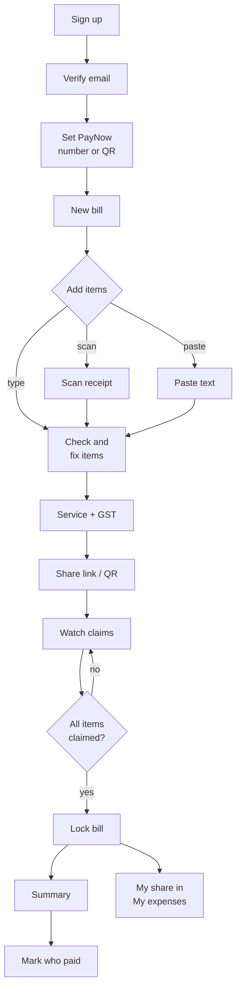

- Three ways to add items: scan a photo, paste receipt text (e.g. from a delivery app or email), or type them in by hand. Scanned and pasted items are always a draft to check.
- The owner can lock with items still unclaimed; those go to the owner and the summary warns about them.

## 2. Guest: pay my share

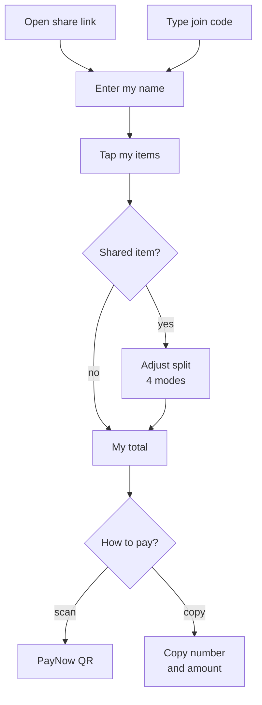

- Two ways in: the share link (or its QR), or the 5-character join code read out at the table.
- No sign-up: the guest only types a name. The guest token is kept in the browser so they can come back and change their claims.
- Claims can be changed until the owner locks the bill.

## 3. Me: track my spending

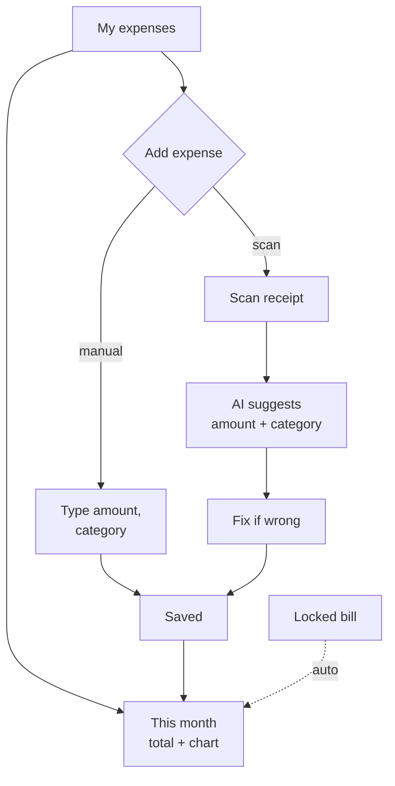

- If I change a category, the app remembers it for that merchant next time.
- Shares from locked bills appear automatically (dashed arrow); I don't add them myself.

## Screens

| #   | Screen               | Shows                                                                   | Actions → endpoint                                                                                                                |
| --- | -------------------- | ----------------------------------------------------------------------- | --------------------------------------------------------------------------------------------------------------------------------- |
| 1   | Login / Register     | Email, password, name (register only), "Have a code?" link              | Log in → `POST /auth/login` · Register → `POST /auth/register` · Have a code? → screen 19                                         |
| 2   | Verify email         | "Check your inbox", resend button                                       | Link in email → `POST /auth/verify-email` · Resend → `POST /auth/resend-verification`                                             |
| 3   | Profile              | Email + verified badge, phone, PayNow number or QR                      | Load → `GET /me` · Save → `PATCH /me` · Upload QR → `POST /me/paynow-qr`                                                          |
| 4   | Home tabs            | Bills · Expenses · Profile                                              | Switches tabs (no call)                                                                                                           |
| 5   | My bills             | List of my bills with status and total                                  | Load → `GET /bills` · New bill → `POST /bills`                                                                                    |
| 6   | Add items            | Choose: scan, paste text or type; camera preview for scan               | Take photo → `POST /bills/:id/receipt` · Paste text → screen 18 · Type it in → screen 7                                           |
| 7   | Edit items           | Item list, add/edit/delete, service and GST, our total vs receipt total | Add → `POST /bills/:id/items` · Edit → `PATCH …/items/:itemId` · Delete → `DELETE …/items/:itemId` · Charges → `PATCH /bills/:id` |
| 8   | Share                | Share link, QR code, 5-character join code, copy button                 | Uses `shareToken` and `joinCode` from the bill (no call)                                                                          |
| 9   | Guest join           | Bill title, "Your name" field                                           | Load → `GET /share/:token` · Join → `POST /share/:token/participants`                                                             |
| 10  | Claim items          | Items with who has claimed each, tap to claim                           | Tap → `POST /share/:token/claims` · Untap → `DELETE /share/:token/claims/:itemId`                                                 |
| 11  | Adjust split (sheet) | Mode buttons (equal / % / shares / exact), one field per person         | Save → `PATCH /share/:token/claims/:itemId`                                                                                       |
| 12  | Summary              | Per-person totals, unclaimed warning, lock button                       | Load → `GET /bills/:id/summary` (owner) or `GET /share/:token/summary` (guest) · Lock → `POST /bills/:id/lock`                    |
| 13  | Pay                  | My total, PayNow QR, copy number, copy amount                           | Load → `GET /share/:token/summary` (QR built from `paynow`)                                                                       |
| 14  | Payment tracker      | Each person, amount, paid or not                                        | Load → `GET /bills/:id/summary` · Toggle → `PATCH /bills/:id/payments/:participantId`                                             |
| 15  | This month           | Month total, category chart, expense list, month picker                 | Load → `GET /expenses/summary?month=` + `GET /expenses?month=`                                                                    |
| 16  | Add expense          | Manual form or scan                                                     | Save → `POST /expenses` · Scan → `POST /expenses/receipt`                                                                         |
| 17  | Edit expense         | Same form, filled in, delete button                                     | Save → `PATCH /expenses/:id` · Delete → `DELETE /expenses/:id`                                                                    |
| 18  | Paste receipt text   | Big text box, hint on where to copy from                                | Read items → `POST /bills/:id/receipt-text` (then screen 7)                                                                       |
| 19  | Enter join code      | 5 boxes for the code                                                    | Join → `GET /join/:code` (then screen 9)                                                                                          |

## Wireframes

Low-fi, grey boxes only: they show what is on each screen, not the final look. Numbers match the screen table above.

| #1 Login / Register                                                              | #2 Verify email                                                                     | #3 Profile                                                                |
| -------------------------------------------------------------------------------- | ----------------------------------------------------------------------------------- | ------------------------------------------------------------------------- |
| 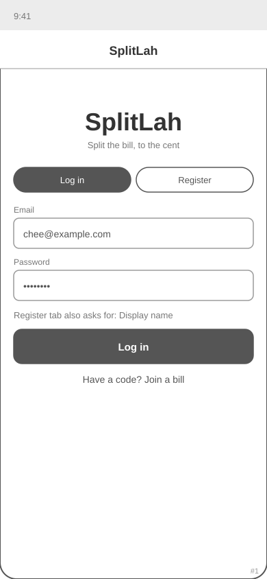 | 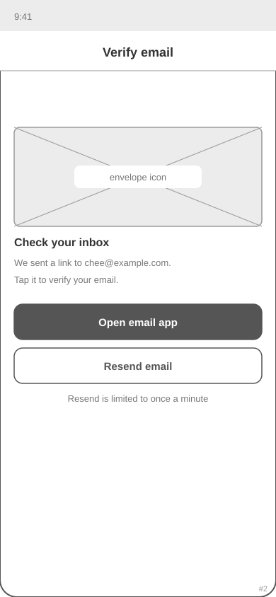 | 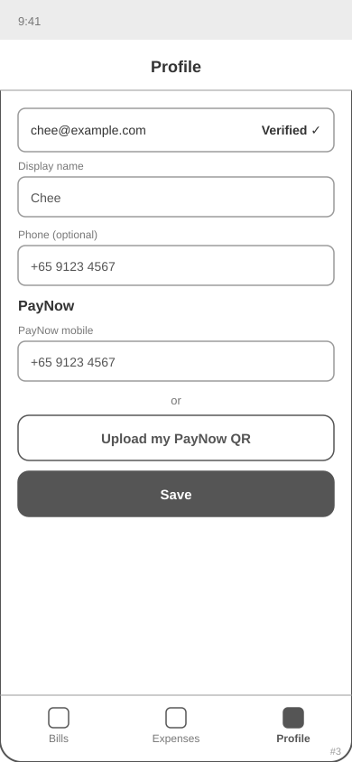 |

| #4 Home tabs                                                                  | #5 My bills                                                                 | #6 Add items                                                                  |
| ----------------------------------------------------------------------------- | --------------------------------------------------------------------------- | ----------------------------------------------------------------------------- |
| 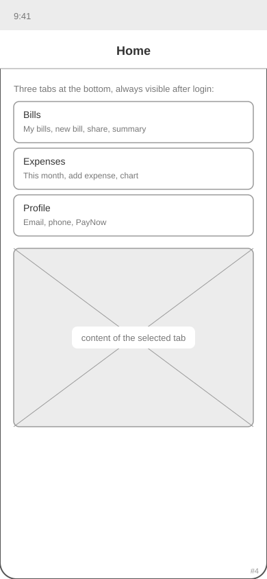 | 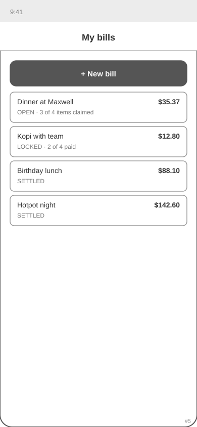 | 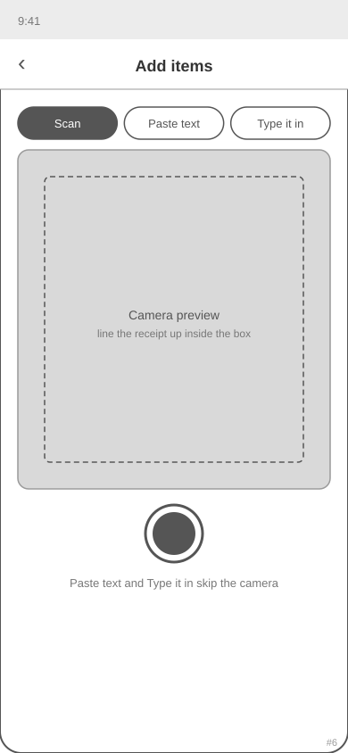 |

| #7 Edit items                                                                   | #8 Share                                                              | #9 Guest join                                                                   |
| ------------------------------------------------------------------------------- | --------------------------------------------------------------------- | ------------------------------------------------------------------------------- |
| 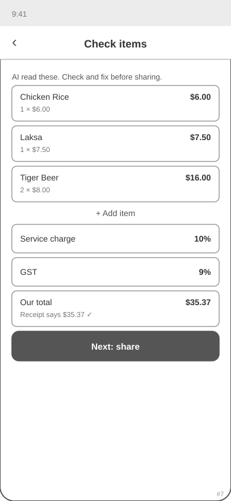 | 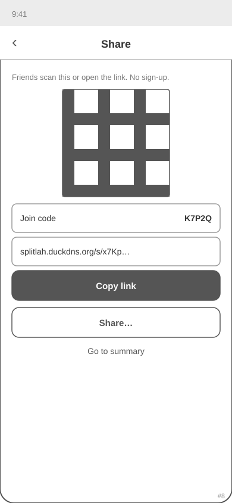 | 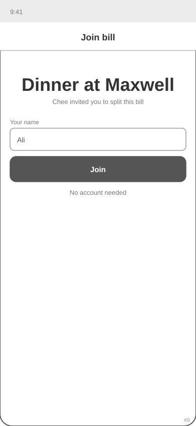 |

| #10 Claim items                                                                   | #11 Adjust split                                                                    | #12 Summary                                                               |
| --------------------------------------------------------------------------------- | ----------------------------------------------------------------------------------- | ------------------------------------------------------------------------- |
| 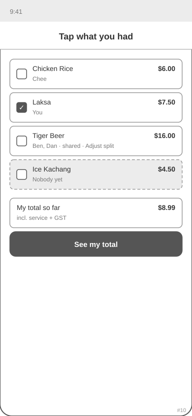 | 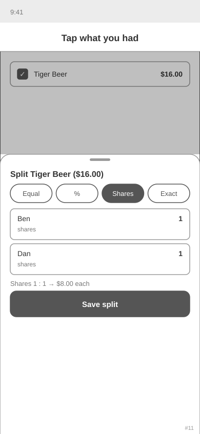 | 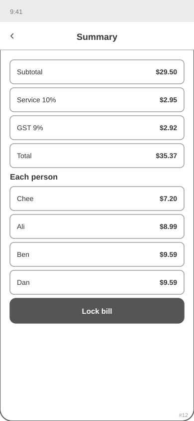 |

| #13 Pay                                                           | #14 Payment tracker                                                                       | #15 This month                                                                  |
| ----------------------------------------------------------------- | ----------------------------------------------------------------------------------------- | ------------------------------------------------------------------------------- |
| 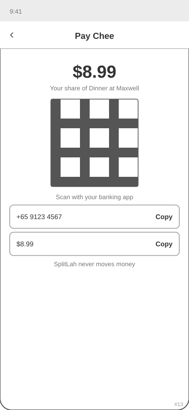 | 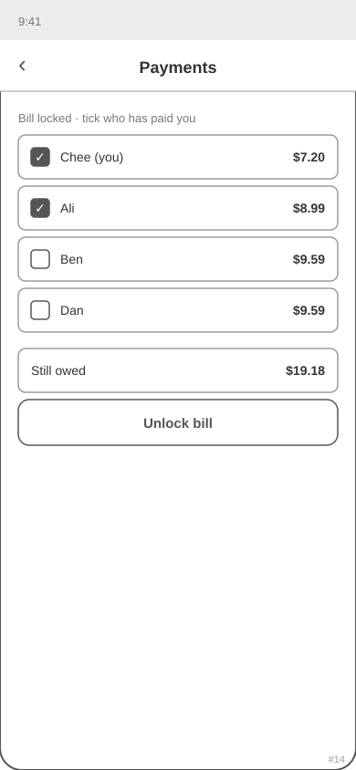 | 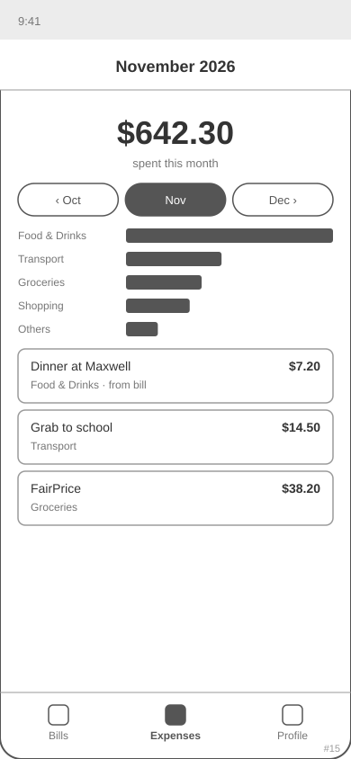 |

| #16 Add expense                                                                   | #17 Edit expense                                                                    | #18 Paste receipt text                                                                  |
| --------------------------------------------------------------------------------- | ----------------------------------------------------------------------------------- | --------------------------------------------------------------------------------------- |
| 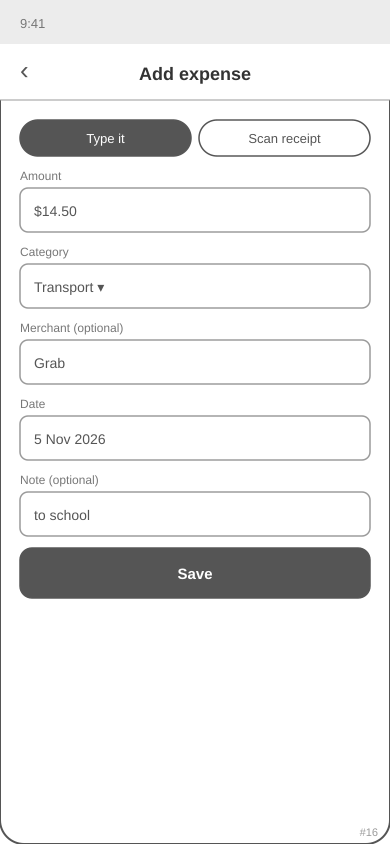 | 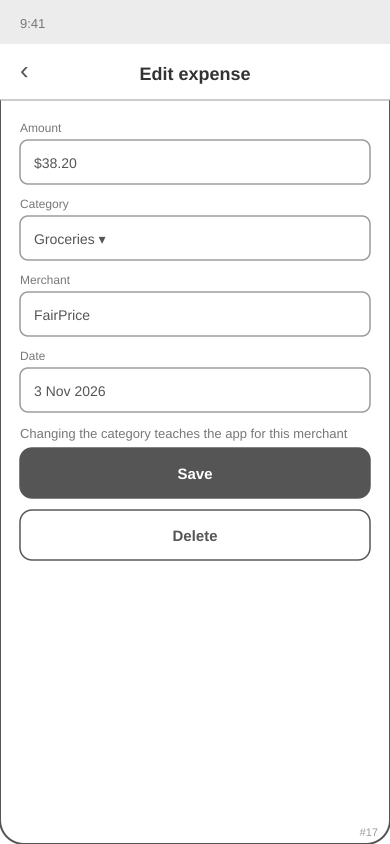 | 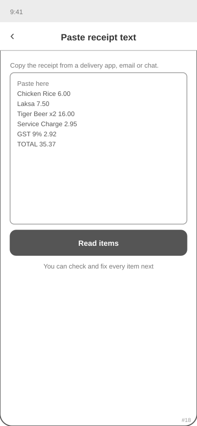 |

| #19 Enter join code                                                                 |
| ----------------------------------------------------------------------------------- |
| 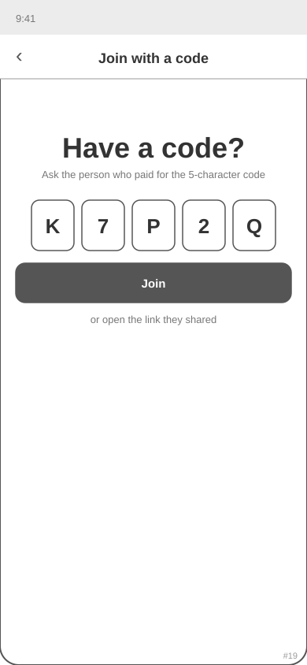 |
